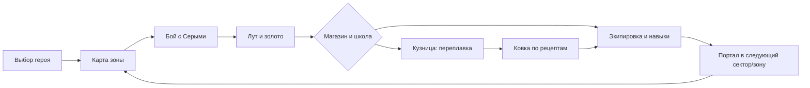
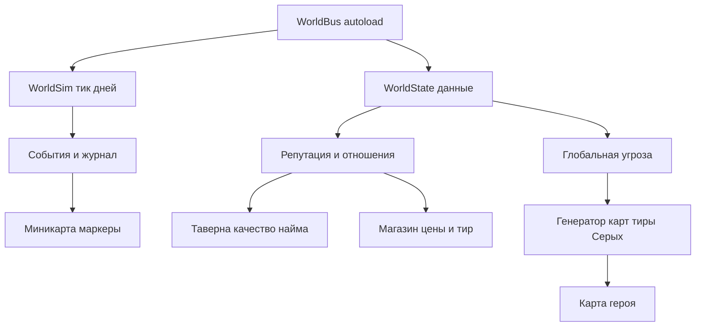

# Видение: каким должен стать Mirotokhome (Allods Home)

> Документ: `Allodshome/docs/audit/03-vision.md`
> **Ревизия 04.11.2026.** Предыдущая версия — 30.09.2026 (история в git).
> Класс игры: **изометрическая тактическая RPG-песочница** («духовный наследник Аллодов II», без кампании).
> Базис: текущее состояние (см. [`01-audit-report.md`](01-audit-report.md)), `AGENTS.md §13`, [`docs/mechanics-roadmap.md`](../mechanics-roadmap.md).
> **Обновление 04.11:** переназначение клавиш, разрушаемые объекты и SIM городов из карты уже сделаны (автотесты; ждут проверки в игре). Второй пакет: закрыты последние P1 — рельеф наёмника и эффекты зелий из данных. В чек-листе сделанное отмечено с оговоркой.

---

## 1. Что значит «идеальная в своём классе»

Для тактической песочницы-наследника Аллодов идеал складывается из трёх опор:

1. **Затягивающее ядро-цикл**: «вышел из города → убил → подобрал лут → продал/переплавил → потратил золото на прокачку и экипировку → стал сильнее → ушёл в следующую зону». Цикл должен работать без разрывов и без «дыр» в экономике.
2. **Живой мир за пределами карты героя**: SIM-слой, который *виден и влияет* на игрока (фракции воюют, города живут, репутация открывает двери, мир давит угрозой), а не тикает вхолостую.
3. **Глубина и отдача**: бой с ощутимым импактом, интересный AI отряда, богатые механики (магия, кузня, алхимия, некромантия), атмосфера (день/ночь, музыка, звук) и стабильные 60 FPS на 1280×800.

---

## 2. Core-loop: что уже замкнуто, а что нет

| Звено цикла | Статус 04.11 | Что осталось |
|---|---|---|
| Выбор героя | ✅ | Два шага, 20/10/0, бронзовый старт, выбор мира/сида/зоны |
| Карта зоны | ✅ | 192×192, 12 секторов, 7 биомов, BlendMesh, туман войны |
| Бой с Серыми | ✅ | 10 видов × 5 тиров, элиты квестов, боссы, сопротивление оружию |
| Лут | ✅ | `LootIcons`, сломанные вещи, бирки фракций, зелья |
| Магазин/школа | ✅ | Репутация → скидка 0–15 %, тиры товаров, книги/свитки |
| Кузница | 🟡 | Переплавка и 48 фракционных рецептов есть; **ковки из слитков по выбору игрока нет** |
| Портал | ✅ | Сектора и цепочка `start→mid→hard`, автосейв до перехода |
| Экономика SIM | 🟡 | `city_economy` читается, города не голодают; но SIM-мир — фикстура, не модель карты |

**Вывод:** цикл почти замкнут. Главная дыра — **кузня не даёт выбрать предмет из слитка**, а SIM-мир не связан с текущей картой. Это две разные задачи: одна про крафт, другая про мир.

---

## 3. Pillar 2 — живой мир

### 3.1 Что уже есть

- **Время:** день мира тикает в живой игре (300 с/день), `day_changed` один раз, журнал ограничен 400 записями.
- **Квесты:** главы городов, ротация по дням, `!`-маркеры, элитные цели, награды; журнал по `W`.
- **События:** стычки NPC vs NPC, маркеры на миникарте, TTL в реальных секундах.
- **Репутация:** читается из `WorldState`, влияет на скидку магазина, тир наёмников, гейты чертежей и эльфийских свитков.
- **Форпосты:** 3 лагеря на карту, стража, захват, бирки, фракционные чертежи.

### 3.2 Что ещё не связано

| Разрыв | Следствие | Куда |
|---|---|---|
| `WorldBus.reseed()` — фикстура (4 фракции, 2 города, 2 армии) | SIM не отражает карту игрока | R-P2-15 |
| `global_threat` не влияет на тиры Серых | «Мир давит» только косметически | R-P3-4 / новая задача |
| Фракционные войны не доходят до карты героя | нет осад, разрушений, беженцев | после SIM-модели |
| Нет диалогов НПЦ | город — набор кнопок, не люди | R-P3-2 |

### 3.3 Целевая связка

---

## 4. Pillar 3 — глубина, отдача, полировка

### 4.1 Системы глубины

| Система | Статус 04.11 | Что закрыть |
|---|---|---|
| Магия (31 заклинание, 5 сфер) | ✅ | Крит не реализован (поля в БД есть) — решить: убрать или сделать |
| Стойки и приказы отряда | ✅ | `follow/attack/guard/stop`, лизы; формации — необязательны |
| Кузница → ковка | 🟡 | Переплавка + рецепты мастерской; **слиток + рецепт → выбранный предмет** |
| Алхимия | 🟡 | Рецепты и травы есть; эффекты зелий захардкожены (R-P1-4) |
| Тиры/элиты/боссы | ✅ | 5 тиров, квестовые элиты, боссовый лут |
| Контракты/квесты | ✅ | Главы городов, ротация, журнал |
| Диалоги НПЦ | 🔴 | Ветки по полу/классу/фракции |
| День/ночь | 🔴 | `time_of_day` из `.alm`, Light2D, ночные мобы |
| Некромантия | 🟡 | `Animate_Dead` работает; нужны контракты «приведи N зомби» |
| Туман войны | ✅ | Маска 0/1/2, шейдер, сохранение в сейве |
| Моды | ✅ | `ModLoader` + `ModsPanel` + `ContentRules`, 4 smoke-теста |

### 4.2 Отдача и полировка

1. **Импакт боя:** screen shake и damage numbers есть; добавить hit-stop 30–60 мс и варианты звука удара.
2. **Аудио:** 8 треков, 5 шин, ducking; осталось — адаптивные слои боя/города и вариации SFX по высоте тона.
3. **AI отряда:** «ближайший враг» → Utility-скоринг (атаковать/лечиться/отступить), скилл `ai-behavior-trees-utility-ai`.
4. **Камера:** зум колесом, lookahead, вспышка на большие события.
5. **Визуальный язык:** наземные телеграфы уже едины (`2d-ground-effects`), распространить на все AoE.
6. **Смерть и загрузка:** сделано; не ломать при будущих фичах (сторож `game_over_smoke`).

### 4.3 Инженерная готовность

| Аспект | Статус 04.11 | Цель |
|---|---|---|
| Производительность | 🟡 | Spatial grid и «ведёрки» A* есть; 100+ юнитов не измерены |
| Сохранения | ✅ | v2, отряд/хотбар/навыки направления, атомарность |
| Ввод | 🔴 | Переназначение клавиш — плацебо (R-P1-12) |
| Настройки | 🟡 | Громкости/видео/UI-масштаб работают; клавиши — нет |
| Локализация | 🟡 | UI 299 EN, предметы 512 EN; квесты/лор — частично |
| CI/автоматизация | 🔴 | Нет `run_all` (R-P2-13) |
| Экспорт | 🔴 | Нет `export_presets.cfg` (R-P2-14) |
| Документация | 🟡 | README/README.dev есть; HOW_TO_RUN и 3 комментария устарели |

---

## 5. Критерии «идеальности» — чек-лист цели

- [x] Core-loop: бой → лут → экономика → прокачка → **следующий сектор/зона** (23.10).
- [x] Тиры/элиты/боссы (17.10, 22.10).
- [x] Контракты в таверне/у глав + журнал `W` (22.10, 28.10).
- [x] Туман войны (19.10).
- [x] Приказы отряда (28.10).
- [x] Музыка и шины (23.10).
- [x] Моды без правки кода (29.10).
- [x] Смерть и загрузка без «ожившего трупа» (04.11).
- [~] **Ковка из слитков**: кузнец/портной делают качество, мастер — +1…+7 (06.11); нужен игровой прогон и баланс.
- [ ] **День/ночь** с освещением и ночными мобами.
- [ ] **Диалоги НПЦ** с ветками.
- [x] **Переназначение клавиш работает** и переживает перезапуск (04.11, автотесты; ждёт игры).
- [x] **Объекты карты разрушаются** огненным шаром, клетка становится проходимой (04.11, автотесты; ждёт игры).
- [~] **SIM связан с картой**: города/армии уже из текущего сектора (04.11); угроза → тиры и войны на карте ещё нет.
- [ ] 60 FPS при 100+ юнитах на 192×192.
- [ ] Экспортируемая сборка Windows запускается из коробки.
- [ ] Документация (HOW_TO_RUN/README.dev/AGENTS) актуальна.
- [ ] EN-локализация без «дыр».

---

## 6. Предлагаемый порядок работ

> Сначала «честные обещания», потом инфраструктура, потом глубина. Каждый пункт — отдельная задача (AGENTS §9.1) с тестами §3 и ручной проверкой.

1. **Фаза 0 — «Честные обещания»** (P1): переназначение клавиш, `damage_area` (решение A/B), эффекты зелий в данные, рельеф наёмника. После неё интерфейс не врёт.
2. **Фаза 1 — «Инфраструктура»** (P2): `run_all`, export presets, доки/комментарии, Linux-пути, миникарта-слой.
3. **Фаза 2 — «Глубина»**: ковка из слитков, день/ночь, диалоги, алхимия на данных.
4. **Фаза 3 — «Живой мир»**: SIM из карты, угроза → тиры, фракционные войны на карте героя.
5. **Фаза 4 — «Полировка»**: hit-stop, адаптивное аудио, Utility-AI, EN-локализация, стресс-тесты 100+ юнитов.

**Правило по ходу:** не добавлять новую систему, пока её экран/обещание не покрыто тестом. Именно этот разрыв дал P1-12 и P1-13.

---

## 7. Чего сознательно НЕ делаем

- Кампания, миссии, катсцены (решение из [`docs/mechanics-roadmap.md`](../mechanics-roadmap.md)).
- Мультиплеер, онлайн-экономика.
- Полная копия баланса/переполнений оригинала.
- Мета-прогрессия вне мира (батлпассы, ежедневки).

---

*Документ — целевое видение, а не план на завтра. Конкретные задачи и проверки — в [`02-recommendations.md`](02-recommendations.md).*
